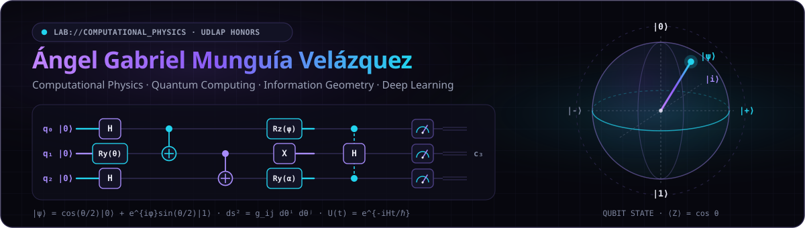

  <a href="https://angelgab3.github.io">
    <picture>
      <source media="(prefers-color-scheme: dark)" srcset="assets/hero-dark.svg" />
      <source media="(prefers-color-scheme: light)" srcset="assets/hero-light.svg" />
      
    </picture>
  </a>

  
  
  
  

 

## About & Research Profile

<table align="center">
  <tr>
    <td width="54%" valign="top">
      
<strong>Physics Honors Undergraduate</strong> at <strong>UDLAP</strong> (<em>GPA 9.5/10 · Full 100% STEM Academic Excellence Scholarship</em>) working at the intersection of <strong>computational physics</strong>, <strong>quantum computing</strong>, <strong>differential &amp; information geometry</strong>, and <strong>deep learning</strong>.

      <ul>
        <li><strong>International Gold Medalist</strong> — Ibero-American Infomatrix Final 2026 (Multimodal LLMs + YOLO + Arduino UNO Q visual assistant)</li>
        <li><strong>2nd Place</strong> — Hackatón Puebla 2026, Microside Water Challenge (<a href="https://github.com/RoshTzsche/gota_poblana">Gota Poblana</a>: adaptive HOCl/pH dosing with ESP32-S3 &amp; Flutter)</li>
        <li><strong>Computational Astrophysics</strong> — Self-Organizing Maps (DESOM) for redshift estimation in submillimeter galaxies (accepted at the 69th National Physics Congress)</li>
        <li><strong>Courses &amp; Outreach</strong> — Instructor of <a href="https://github.com/AngelGab3/Summer-Lectures-2026.-Deep-Learning-A-Mathematical-Physics-Approach">Summer Lectures 2026</a>, Puebla Planetarium speaker, and UDLAP STEM Quantum Computing instructor</li>
        <li><strong>Robotics &amp; iOS</strong> — TMR Electronics &amp; Control Lead (custom ESP32 PCBs) &amp; National Finalist at iOS Development Lab</li>
      </ul>
    </td>
    <td width="46%" valign="middle" align="center">
      <a href="https://angelgab3.github.io">
        <picture>
          <source media="(prefers-color-scheme: dark)" srcset="https://raw.githubusercontent.com/AngelGab3/AngelGab3.github.io/main/docs/screenshots/hero-dark.png" />
          <source media="(prefers-color-scheme: light)" srcset="https://raw.githubusercontent.com/AngelGab3/AngelGab3.github.io/main/docs/screenshots/hero-light.png" />
          
        </picture>
      </a>
       
      Explore the interactive mathematical simulations live at <a href="https://angelgab3.github.io"><b>angelgab3.github.io</b></a>
    </td>
  </tr>
</table>

---

## Featured Research & Engineering

<table align="center">
  <tr>
    <td width="50%" valign="top">
      <b><a href="https://github.com/AngelGab3/Quantum-Computing">⚛️ Quantum-Computing</a></b> 
      <code>|ψ⟩ = cos(θ/2)|0⟩ + e^{iφ}sin(θ/2)|1⟩</code>  
      Qiskit circuits, unitary operators, Bloch sphere simulations, and mathematical derivations linking complex Hilbert spaces to quantum algorithms (Deutsch–Jozsa, Grover, QFT).
    </td>
    <td width="50%" valign="top">
      <b><a href="https://github.com/AngelGab3/Final_Project_Optics_Difractive_Neural_Networks">🔬 Diffractive Neural Networks (D²NN)</a></b> 
      <code>U(z) = ℱ⁻¹{ H_BL(u,v;z) · ℱ{U₀·e^{iΦ}} }</code>  
      Visible-wavelength phase-only optical neural networks modeled via band-limited angular spectrum propagation, Fresnel scaling, and Wirtinger gradient backpropagation.
    </td>
  </tr>
  <tr>
    <td width="50%" valign="top">
      <b><a href="https://github.com/AngelGab3/Geometry_and_Physics">📐 Geometry_and_Physics</a></b> 
      <code>ds² = g_ij(θ) dθⁱ dθʲ · d² = 0</code>  
      Formal LaTeX notes bridging Euclidean vector calculus with Riemannian metric tensors, Cartan moving frames, physical topology, and symplectic mechanics on <i>T*Q</i>.
    </td>
    <td width="50%" valign="top">
      <b><a href="https://github.com/AngelGab3/GalaxyAE">🌌 GalaxyAE</a> &amp; <a href="https://github.com/AngelGab3/MaNGA-DESOM">MaNGA-DESOM</a></b> 
      <code>z = f_θ(x) · DESOM Topology</code>  
      Deep Embedded Self-Organizing Maps and Autoencoder pipelines for unsupervised spectroscopic galaxy clustering and topological manifold preservation.
    </td>
  </tr>
  <tr>
    <td width="50%" valign="top">
      <b><a href="https://github.com/RoshTzsche/gota_poblana">💧 Gota Poblana</a></b> 
      <code>α_HOCl = 1 / (1 + 10^(pH − pKa(T)))</code>  
      2nd Place at Hackatón Puebla 2026: offline adaptive pH dosing controller for free-chlorine efficacy using ESP32-S3 firmware, Flutter app, MQTT, and deterministic HIL simulation.
    </td>
    <td width="50%" valign="top">
      <b><a href="https://github.com/AngelGab3/Summer-Lectures-2026.-Deep-Learning-A-Mathematical-Physics-Approach">📚 Summer Lectures 2026</a></b> 
      <code>∇_g L(θ) = G⁻¹(θ) ∇L(θ)</code>  
      Course designed and taught from first principles connecting numerical analysis, Hilbert spaces, Hessians, and optimizer dynamics to modern deep learning in PyTorch.
    </td>
  </tr>
</table>

---

## Tech Stack

**Quantum, Numerical &amp; AI**

**Hardware, Embedded &amp; Systems**

---

## Contribution Activity

  <picture>
    <source media="(prefers-color-scheme: dark)" srcset="https://raw.githubusercontent.com/AngelGab3/AngelGab3/output/github-snake-dark.svg" />
    <source media="(prefers-color-scheme: light)" srcset="https://raw.githubusercontent.com/AngelGab3/AngelGab3/output/github-snake-light.svg" />
    
  </picture>

---

  <i>"When computing meets Physics"</i> &nbsp;·&nbsp; <a href="https://angelgab3.github.io">angelgab3.github.io</a> &nbsp;·&nbsp; <a href="mailto:angel.munguiavz@udlap.mx">angel.munguiavz@udlap.mx</a>

